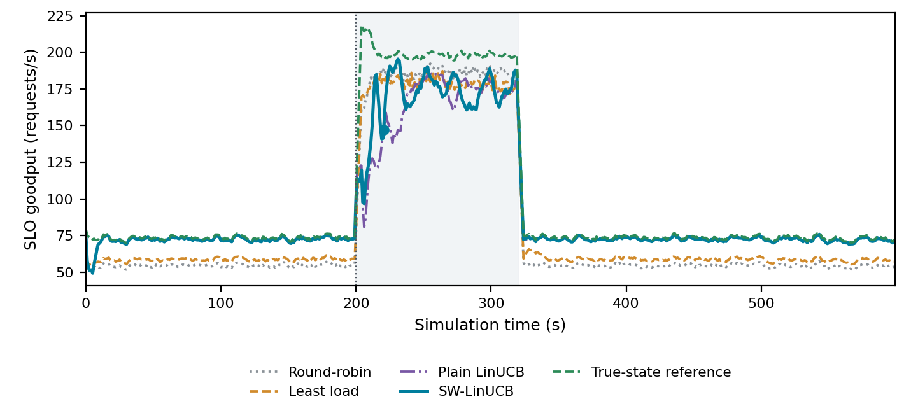
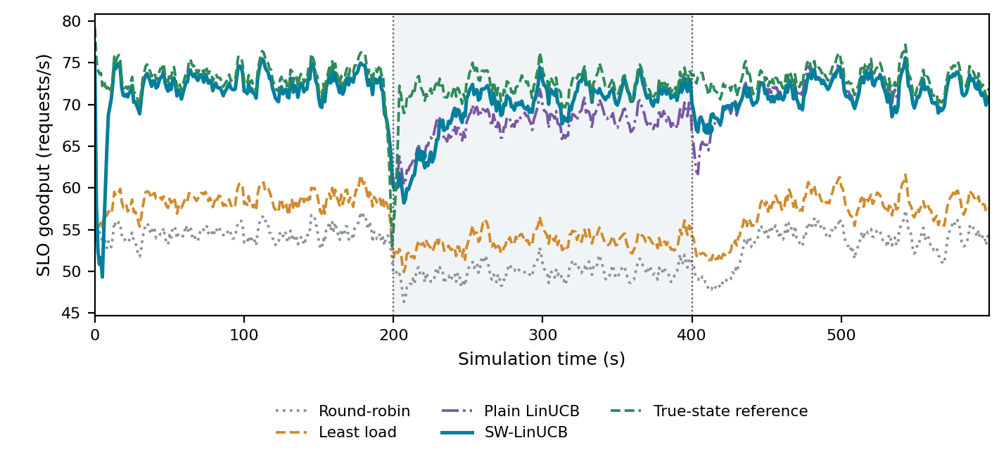

# Change-Aware, Feasibility-First Scheduling for Geo-Distributed AI Inference

AMS 560 - Group 20 - Final Project Report

Jyotir Patel, Krupesh Desai, Parikshit, Sur and Riya

## Abstract

We evaluate a two-stage inference scheduler that first enforces feasibility from node telemetry and then uses a contextual bandit to select a destination. Sliding-window LinUCB adapts to changing conditions by retaining recent feedback per node. A heterogeneous five-site simulator replays six controlled scenarios. The final frozen evaluation contains 420 main policy runs, 120 additional ablation runs and 60 privileged reference runs, with ten matched seeds per configuration. Goodput, tail latency, resource cost, safety and recovery are computed from persisted decision logs with seed-level bootstrap intervals. Historical mock runs and earlier tuning sweeps are kept separate from the final comparison.

In S2, SW-LinUCB achieves 91.85 [91.43, 92.23] SLO requests/s; its paired difference from least load is 9.16 [8.70, 9.55] requests/s. All bracketed ranges are 95% bootstrap intervals. These figures describe the simulator configuration rather than a measured production deployment.

## 1. Problem and system design

A geo-distributed inference router must choose a GPU site while requests, network conditions, energy prices and machine availability change. Choosing the cheapest or closest site alone can miss latency targets or overload a preferred site. Our objective is SLO-compliant goodput under explicit model, memory, power, temperature and availability constraints. Existing LinUCB algorithms are components of the system, not new algorithms introduced by this project [1,2].

Requests enter Krupesh's routing engine. Jyotir's filter removes nodes that fail the hard rules. A baseline or learning policy chooses from the allowed set. Parikshit's simulator returns delayed outcomes, and Sur's policy updates only after feedback. The engine writes one decision-log row per request, including rejections, failures, completion times, cost and independent true-state annotations. Riya's runner executes the grid, verifies the saved bundles, and derives all tables and figures from them.

| Filter rule | Required condition |
| --- | --- |
| Status / model | Node is up or permitted warming, and requested model is loaded. Warming nodes still undergo all remaining checks. |
| Memory | Estimated existing plus requested KV tokens do not exceed 90% of capacity; use a fraction fallback when token capacity is absent. |
| Power / temperature | At least 2 kW headroom and temperature below 85 C in the router's view. |

The router checks current eligibility again after selection and tracks its own pending placements for load. The simulator separately evaluates the chosen node's true state at dispatch. These checks answer different questions: a telemetry-based audit can pass while stale state conceals a physical threshold crossing.

## 2. Learning method and evaluation setup

LinUCB maintains a ridge-regularized reward model per node. Its score combines predicted reward and an exploration bonus: θᵀx + α√(xᵀA⁻¹x). The context encodes request size/SLO, RTT, queue and slot use, KV occupancy, prices, temperature and warm-up state. Sliding-window LinUCB removes old feedback; plain LinUCB retains all observations. The final default is alpha=1, ridge=1 and the last W=500 outcomes per node. This choice is supported by Sur's earlier sweep, which is not pooled into the final experiment [1,2].

Reward is SLO success minus weighted normalized TTFT, energy cost and thermal stress. We retain weights 1.0/0.2/0.1/0.1 and an energy-cost normalization of USD 0.00001. Parameters are captured from the policy YAMLs; the final comparison holds these settings fixed. The no-context variant replaces request/node features with a constant; the no-forgetting comparison uses plain LinUCB.

| Setting | Final value |
| --- | --- |
| Cluster | Five sites: New York and San Jose with H100 GPUs; Buffalo, Albany and Los Angeles with A100 GPUs. |
| Workload | Processed Azure conversation/code traces; base rate 80 requests/s; 600-second arrivals, then drain outstanding requests. Interactive TTFT SLO 250 ms; batch SLO 1000 ms. |
| Policies / repetition | Five static baselines plus plain and sliding-window LinUCB; six scenarios and seeds 0-9. Main grid = 420 runs. Two additional ablations = 120 runs; true-state reference = 60 runs. |
| Uncertainty | 95% percentile bootstrap intervals for means across seeds; 2,000 resamples with fixed bootstrap RNG. Paired effects resample seed-matched differences. |
| Inputs | Public request traces, NYISO/CAISO day-ahead prices, inter-city RTTs and a calibrated latency model. Exact processed bytes/configs are saved with source hashes. |

| Scenario | Change |
| --- | --- |
| S1 | Stable control; pseudo-event at 200 s for recovery-noise diagnostics. |
| S2 | Arrival rate triples for 120 s from 200 s. |
| S3 | Electricity prices shift at 200 s. |
| S4 / S5 | New York thermal stress / an additional 80 ms network delay at 200 s. |
| S6 | New York fails at 200 s; returns at 400 s and warms for 60 s. |

Overall and time-series goodput both use arrival cohorts, including drained outcomes. Latency p95/p99 use completed, nonfailed requests, including late requests. Rejected requests consume no simulator-attributed GPU rent or energy; router overhead is excluded. Missing routed-outcome resources remain unavailable. Cost includes attributed electricity and GPU rent, not just electricity.

## 3. Main goodput results

Each entry is mean SLO goodput in requests/s [95% bootstrap CI], based on ten seeds. Compare policies within a scenario: S2 has a larger request count, so its absolute goodput is not directly comparable to stable operation.

| Policy | S1 | S2 | S3 |
| --- | --- | --- | --- |
| Round-robin | 54.51 [54.33, 54.67] | 80.57 [80.43, 80.74] | 54.51 [54.34, 54.66] |
| Minimum RTT | 58.54 [58.37, 58.72] | 62.67 [62.45, 62.93] | 58.54 [58.36, 58.73] |
| Least load | 58.52 [58.37, 58.68] | 82.69 [82.39, 82.97] | 58.52 [58.37, 58.68] |
| Lowest energy | 61.15 [60.99, 61.33] | 85.86 [85.69, 86.03] | 53.98 [53.83, 54.13] |
| Static weighted | 58.97 [58.83, 59.10] | 80.58 [79.82, 81.33] | 58.96 [58.82, 59.09] |
| Plain LinUCB | 72.26 [71.95, 72.61] | 90.62 [89.85, 91.31] | 72.26 [71.94, 72.59] |
| SW-LinUCB | 72.26 [71.96, 72.59] | 91.85 [91.43, 92.23] | 72.26 [71.94, 72.60] |

| Policy | S4 | S5 | S6 |
| --- | --- | --- | --- |
| Round-robin | 53.02 [52.86, 53.18] | 53.37 [53.21, 53.53] | 52.61 [52.48, 52.76] |
| Minimum RTT | 52.27 [52.12, 52.43] | 49.64 [49.49, 49.78] | 53.32 [53.16, 53.49] |
| Least load | 56.48 [56.34, 56.63] | 57.00 [56.85, 57.14] | 56.39 [56.24, 56.54] |
| Lowest energy | 61.15 [60.99, 61.33] | 61.15 [60.99, 61.33] | 61.15 [60.99, 61.33] |
| Static weighted | 56.67 [56.52, 56.82] | 54.59 [54.46, 54.72] | 56.39 [56.24, 56.56] |
| Plain LinUCB | 71.39 [70.78, 71.94] | 70.49 [68.94, 71.89] | 70.16 [69.95, 70.37] |
| SW-LinUCB | 71.28 [70.59, 71.88] | 70.52 [69.03, 71.89] | 70.80 [70.27, 71.29] |

## Paired goodput effects

For S2, SW-LinUCB minus plain LinUCB is 1.23 [0.65, 1.94] requests/s. These are paired seed differences rather than a test based on overlapping marginal intervals.

The S4 thermal comparison against plain LinUCB is -0.11 [-0.29, 0.01] requests/s. The S1 stable comparison is 0.00 [0.00, 0.00] requests/s. Forgetting should therefore be assessed scenario by scenario rather than assumed to improve stationary or thermal behavior uniformly.

Across the 30 main policy/scenario comparisons against static baselines, the paired 95% interval for SW-LinUCB's goodput improvement lies entirely above zero in 30. These are individual comparisons without a multiple-testing adjustment; their intervals should not be read as a family-wide guarantee.

Goodput alone does not establish price-aware routing. Under S3, SW-LinUCB costs 0.000268 [0.000266, 0.000270] USD per SLO success; lowest energy costs 0.000360 [0.000359, 0.000362]. These accounting results do not by themselves isolate a causal response to prices.

## 4. Recovery and the true-state reference

Goodput is binned in one-second intervals and smoothed by a trailing five-second mean. For a change at t0, G* is the mean over [t0+60,t0+120). Adaptation time is the first start at or after t0 of ten consecutive bins at or above 0.9 G*, minus t0. The search continues to the last possible hold within the run. Non-recovery stays missing rather than being assigned zero. Deepest dip is the minimum over the first 120 seconds.

| Policy / event | Adaptation s [95% CI] | G* req/s [95% CI] | Event node share % [95% CI] | Recovered |
| --- | --- | --- | --- | --- |
| Plain LinUCB / S2 burst | 33.60 [25.30, 41.60] | 175.41 [170.91, 179.31] | Not applicable | 10/10 |
| SW-LinUCB / S2 burst | 20.40 [17.90, 22.30] | 174.11 [170.82, 177.22] | Not applicable | 10/10 |
| Plain LinUCB / S6 outage | 9.90 [2.70, 19.00] | 68.18 [67.68, 68.86] | 0.0 [0.0, 0.0] | 10/10 |
| SW-LinUCB / S6 outage | 18.30 [9.30, 27.40] | 70.45 [69.13, 71.65] | 0.0 [0.0, 0.0] | 10/10 |
| Plain LinUCB / S6 return | 14.70 [7.70, 22.80] | 72.55 [71.77, 73.31] | 42.0 [34.4, 50.1] | 10/10 |
| SW-LinUCB / S6 return | 10.70 [3.50, 18.70] | 72.11 [70.85, 73.16] | 31.0 [22.0, 40.6] | 10/10 |
| Lowest energy / S6 return | 7.40 [0.80, 16.70] | 61.30 [60.39, 62.12] | 0.0 [0.0, 0.0] | 10/10 |

Delay intervals are conditional on recovered seeds; recovery counts are shown explicitly. Node shares use all arrivals in the G* window as the denominator. The stable pseudo-event detects false recovery delays caused by normal workload noise. It is not a real adaptation experiment.

Plain LinUCB: 4/10 stable seeds have positive pseudo-delays, spanning 4-12 s. The false-delay fraction is 0.40 [0.10, 0.70]. This is the control noise floor for interpreting event delays.

SW-LinUCB: 4/10 stable seeds have positive pseudo-delays, spanning 4-12 s. The false-delay fraction is 0.40 [0.10, 0.70]. This is the control noise floor for interpreting event delays.

The returned node's traffic share must accompany S6 timing. For SW-LinUCB, its steady-window share after the return is 31.0 [22.0, 40.6]%. A short recovery time accompanied by near-zero share would indicate abandonment rather than useful recovery.

## Reference definition and lost goodput

The privileged reference refreshes true state on every arrival, checks actual token admission and immediate capacity, then selects the node with the lowest model TTFT. It is greedy and has no future-event lookahead, so it is not a proven global upper bound. Reference-relative lost goodput sums the positive smoothed-goodput deficit over [t0,t0+120), with identical scenario, seed and workload fingerprints. Ordinary policies may outperform this reference in some intervals; negative differences do not cancel positive deficits.

For SW-LinUCB after the S2 change, reference-relative lost goodput is 3593.4 [3444.1, 3749.7] requests. The reference G* is 198.10 [197.23, 198.91] requests/s. This operational measure is reported separately from globally optimal regret.

## 5. Ablations, cost and safety

Mean goodput [95% CI] for the complete policy and three component removals. Plain LinUCB is the no-forgetting ablation already present in the main grid; its runs are not duplicated.

| Scenario | Complete | No filter | No context | No forgetting |
| --- | --- | --- | --- | --- |
| S1 | 72.26 [71.96, 72.59] | 72.19 [71.90, 72.53] | 72.40 [72.16, 72.62] | 72.26 [71.95, 72.61] |
| S2 | 91.85 [91.43, 92.23] | 82.64 [81.21, 84.09] | 55.72 [52.95, 59.58] | 90.62 [89.85, 91.31] |
| S3 | 72.26 [71.94, 72.60] | 72.19 [71.88, 72.54] | 72.46 [72.22, 72.69] | 72.26 [71.94, 72.59] |
| S4 | 71.28 [70.59, 71.88] | 71.16 [70.06, 71.97] | 72.19 [71.98, 72.40] | 71.39 [70.78, 71.94] |
| S5 | 70.52 [69.03, 71.89] | 71.02 [69.66, 72.06] | 72.12 [71.92, 72.31] | 70.49 [68.94, 71.89] |
| S6 | 70.80 [70.27, 71.29] | 70.78 [70.08, 71.39] | 71.97 [71.77, 72.17] | 70.16 [69.95, 70.37] |

The S2 paired goodput effect of retaining context is 36.13 [32.26, 38.98] requests/s. The effect of retaining the feasibility filter is 9.21 [7.55, 10.87] requests/s. These estimates describe this workload and configuration, not every possible deployment.

Context does not improve every condition. In S6, the paired effect of retaining context is -1.17 [-1.64, -0.75] requests/s, favoring the constant-context variant. The full intervals in the analysis bundle also favor no context in S4 and S5. The strong S2 gain therefore does not establish a universal advantage from this feature set.

| SW-LinUCB metric | S1 | S2 | S6 |
| --- | --- | --- | --- |
| p95 TTFT (ms) | 444.4 [441.1, 447.6] | 821.7 [754.8, 903.7] | 504.2 [472.2, 542.8] |
| p99 TTFT (ms) | 688.2 [679.1, 697.5] | 2431.2 [2202.7, 2690.6] | 874.7 [754.5, 1019.9] |
| USD / SLO success | 0.000267 [0.000265, 0.000269] | 0.000260 [0.000258, 0.000263] | 0.000258 [0.000246, 0.000270] |
| kWh / SLO success | 0.0000511 [0.0000509, 0.0000514] | 0.0000551 [0.0000547, 0.0000555] | 0.0000515 [0.0000498, 0.0000533] |

Safety is measured independently at dispatch. For S2, the fraction of routed requests with simulator-observed true-state violations is 4.79 [4.41, 5.19]% with the complete policy and 12.41 [11.58, 13.17]% without the filter. A successful run status means execution/log validation passed; it is not a safety certificate.

GPU and energy charges follow the simulator's request-attribution model. They do not measure an actual energy bill. Queueing and request-length mixtures also mean that high goodput need not coincide with the smallest tail latency. Full latency, rejection, failure, cost and energy tables are included in the accompanying analysis bundle.

## 6. Discussion, validation and conclusion

The experiment tests a complete scheduling loop under heterogeneous GPUs and controlled changes. Context can encode request-length and node-type interactions that static rules miss, while forgetting limits the influence of feedback collected before a change. The main comparisons and paired effects quantify these benefits without assuming that the adaptive policy must win every metric. The SLO-dominated reward does not guarantee an economically optimal allocation. A dedicated routing-share analysis and a controlled sweep of reward weights would be needed to establish how much S3 routing responds to electricity prices.

Telemetry age remains a material limitation. The router accounts for recent placements in load but does not fully predict their effect on temperature or power between ticks. The filter therefore guarantees eligibility only against its current view. Independent true-state annotations expose this gap. Reducing the telemetry interval or adding calibrated placement accounting requires a new experiment rather than silently changing this result bundle.

The simulation omits several real serving-engine effects. Prefill has no direct load penalty; service times are fixed at job start; warm-up, thermal and power dynamics include assumptions. The base burst may remain below aggregate cluster capacity, although concentrated routing can still cause overload. Wholesale prices and historical inter-city pings differ from retail site tariffs and current network measurements. The privileged reference is myopic, and the fixed 120-second deficit window is an operational choice. Five-node results do not establish ten-node scalability or production performance.

## Integration validation

The old 420-run source record was compared across Windows/Linux paths and LF/CRLF conventions. Four files had content changes, including the feasibility filter and simulator, so the final runs were regenerated. Two stale assertions were replaced with checks for unsafe warming-node rejection and exactly one failure for an oversized request. Riya's 26 metric/integration checks, Jyotir's 28 filter tests, 34 router tests (one optional skip), 121 simulator tests (one optional skip), and 228 policy tests passed independently. The final frozen bundle also undergoes raw-log metric replay, file-hash checks, complete-grid checks and paired-workload validation. Module test counts and skips are recorded in the validation notes rather than added together as one test suite.

## Reproducibility

The bundle records base repository commit d997af8dc500, SHA256 hashes, exact code/config/data snapshots, package versions, per-run seeds and policy settings. Raw logs are Parquet; every figure and table reads saved bundles. Workers run independent seeded simulations with one BLAS thread. The main grid, two extra ablations and privileged reference have separate roles even though one command executes the complete 600-run configuration.

## Conclusion

A feasibility-first contextual scheduler provides a reproducible way to study adaptive geo-distributed inference. The final evaluation reports goodput jointly with recovery level, latency, resource cost, node usage and true-state violations. Its conclusions are limited to the recorded simulator configuration. Future work should validate the simulator on a serving engine, strengthen telemetry-aware admission, and evaluate reward changes and larger clusters without reusing incompatible results.

## 7. Goodput around workload changes

Seed-mean arrival goodput, smoothed over five seconds. Dots show SW-LinUCB mean recovery times conditional on recovery; vertical lines mark change events. Selected policies are shown for readability. The complete figure bundle includes all six scenarios and the metric comparison charts.

Traffic burst at 200 seconds

Outage at 200 seconds and return at 400 seconds

## References

[1] L. Li, W. Chu, J. Langford and R. E. Schapire. A Contextual-Bandit Approach to Personalized News Article Recommendation. WWW, 2010, pp. 661-670. DOI: 10.1145/1772690.1772758.

[2] W. C. Cheung, D. Simchi-Levi and R. Zhu. Learning to Optimize under Non-Stationarity. AISTATS, PMLR 89, 2019, pp. 1079-1087. https://proceedings.mlr.press/v89/cheung19b.html

[3] Project simulator calibration, data provenance and processed input checksums: Parikshit/simulator/NUMBERS.md; Parikshit/data/processed/manifest.json. Method-selection evidence: Sur/window_sweep/RESULTS.md.
